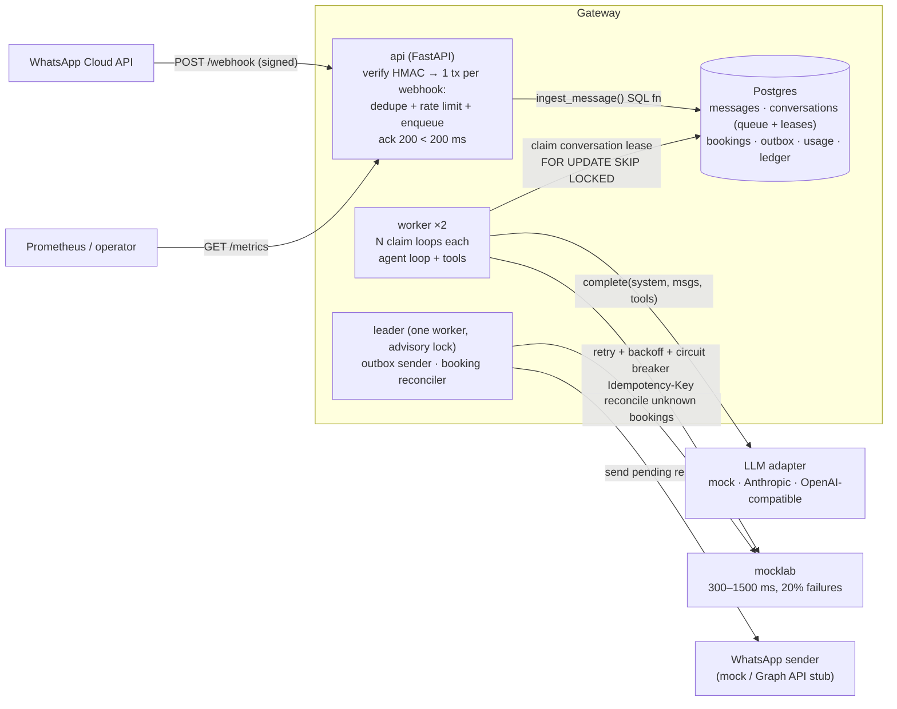

# PLAN: WhatsApp Agent Gateway for a diagnostic lab

> Status: the first deliverable, written before any application code. The detailed engineering spec lives in `BUILD_PROMPT.md` (v2). This document is the reviewer-facing plan.

## 1. Problem

A diagnostic lab takes test-booking requests over WhatsApp. Three things make this hard:

- **Webhooks are unreliable in delivery.** Meta's Cloud API sends them in bursts, retries anything that isn't a fast 2xx, and sometimes delivers the same message twice.
- **The lab's booking API is slow (0.3–1.5 s) and flaky (about 20% failures).** That includes failures where the booking *did* happen but the response was lost.
- **A patient must never be double-booked, and neither can a slot.**

We need a gateway with four properties:

1. It acknowledges webhooks in under 200 ms.
2. It processes each message once, in order per user.
3. It runs an LLM agent that can check slots, book and hand off to a human.
4. It survives the flaky lab without creating duplicate bookings, and it shows what it costs.

## 2. Users

| User | Needs |
|---|---|
| **Patient** (WhatsApp) | Book a test in a few messages. Get a clear confirmation. Reach a human for medical questions or complaints. |
| **Lab front-desk staff** | Receive handoffs with a reason and summary. Release a conversation back to the bot. Re-drive failed messages. |
| **Lab ops / engineering** | `/metrics` for latency, queue depth, retries, bookings, handoffs, and tokens and cost per conversation. A DLQ for poison messages. |
| **Lab finance** | A monthly LLM and infra cost they can predict (`COST.md`). |

## 3. Architecture



### Request path (hot)

1. Cap the body at 256 KB, then check `X-Hub-Signature-256` (HMAC-SHA256 over the raw body, constant-time compare). A bad signature returns **401 before any JSON parsing**.
2. Parse into Pydantic models. Status callbacks are ignored. Each message in the webhook gets one call to the `ingest_message()` SQL function, all **inside one transaction**.
3. The function does the following in a single round trip:
   - Dedupe: `INSERT … ON CONFLICT (wa_message_id) DO NOTHING`.
   - Rate limit: atomic token bucket.
   - Rate-limit notice: if limited and no notice has gone out this window, insert one outbox row.
   - Enqueue: mark the conversation `has_pending`.
4. Return 200. There are no LLM, lab or outbound HTTP calls on this path.

### Work path (async)

1. A worker loop claims **a conversation** (not a single message) by setting a lease with `SKIP LOCKED`. The lease guarantees one worker per conversation, which gives per-user ordering.
2. It loads all queued messages for that conversation, in order. Several queued messages are coalesced into one agent turn.
3. It runs the agent: up to 4 LLM calls and tool executions, with heartbeats extending the lease.
4. It commits in one transaction, guarded by the lease token:
   - mark messages `done`
   - save state and history
   - insert outbox replies
   - release the lease
5. If the lease was lost (for example the worker stalled and another worker took over), the commit is skipped. Every side effect is idempotent, so the redo is safe.

### Why Postgres is the queue

Dedupe and enqueue are atomic. There is no dual-write to Redis and one fewer component to fail. Postgres handles the brief's load with a wide margin: 1M messages a month is about 0.4 msg/s on average and bursts of about 50 msg/s.

## 4. Data model

All timestamps are `timestamptz`. Times shown to users are converted to Asia/Kolkata.

| Table | Columns (key ones) | Keys / constraints / indexes | Purpose |
|---|---|---|---|
| `conversations` | `id bigserial PK`, `phone text`, `state text`, `context jsonb`, `history jsonb`, `has_pending bool`, `pending_since`, `next_attempt_at`, `lease_token uuid`, `lease_until`, `updated_at` | `UNIQUE(phone)`; `CHECK state IN (NEW, COLLECTING, SLOTS_OFFERED, BOOKING_PENDING, BOOKED, HANDOFF)`; partial index `(pending_since) WHERE has_pending` | Conversation state. Also acts as the **queue unit**, with leases as the visibility timeout. |
| `inbound_messages` | `id bigserial PK`, `wa_message_id text`, `conversation_id FK`, `phone`, `msg_type`, `body`, `wa_timestamp`, `status`, `attempts int`, `last_error`, `received_at` | **`UNIQUE(wa_message_id)`** (dedupe); `CHECK status IN (queued, done, rate_limited, held, dead)`; index `(conversation_id, status, id)` | Every unique inbound message. `dead` is the DLQ. |
| `duplicate_deliveries` | `id`, `wa_message_id`, `received_at` | append-only | Counts dedupe hits without a hot counter row. |
| `rate_limits` | `phone PK`, `tokens double`, `updated_at`, `last_notice_at` | | Token bucket per phone. |
| `bookings` | `id`, **`idempotency_key text`**, `attempt_no int`, `conversation_id`, `phone`, `test_code`, `slot_id`, `patient_name`, `status`, `lab_booking_id`, `last_error`, `created_at`, `updated_at` | **`UNIQUE(idempotency_key)`**; **partial `UNIQUE(slot_id) WHERE status IN (pending, confirmed, unknown)`**; **partial `UNIQUE(phone, test_code) WHERE status IN (pending, confirmed, unknown)`**; `CHECK status IN (pending, confirmed, unknown, failed)` | Local source of truth that makes double booking **impossible**. |
| `lab_calls` | `id`, `endpoint`, `idempotency_key`, `attempt`, `outcome`, `http_status`, `latency_ms`, `created_at` | index `(created_at)` | One row per HTTP attempt. Retry and outcome metrics come from here. |
| `outbound_messages` | `id`, `conversation_id`, `phone`, `body`, **`dedupe_key`**, `status`, `attempts`, `next_attempt_at`, `created_at`, `sent_at` | **`UNIQUE(dedupe_key)`**; partial index `(next_attempt_at) WHERE status='pending'` | Transactional outbox. |
| `llm_usage` | `id`, `conversation_id`, `mode`, `model`, `input_tokens`, `output_tokens`, `cache_read_tokens`, `cache_write_tokens`, `cost_usd numeric NULL`, `created_at` | index `(conversation_id)` | Every LLM call, mock or real. Feeds the per-conversation metrics. `NULL` cost means the price is unknown. |
| `llm_spend_ledger` | same columns as `llm_usage`, real calls only | append-only, **never truncated** | Survives load-test resets. The budget guard and `spend_report.py` read it. |
| `handoffs` | `id`, `conversation_id`, `reason`, `summary`, `created_at`, `released_at` | index `(conversation_id)` | Queue for staff. |
| `events` | `id`, `kind`, `conversation_id NULL`, `detail jsonb`, `created_at` | index `(kind)` | Append-only operational events: `circuit_opened`, `loop_limit`, `budget_refused`, `dlq`, `lease_lost`. |
| `worker_heartbeats` | `worker_id PK`, `last_seen`, `is_leader` | | Liveness metric. |

## 5. API contract

### 5.1 `GET /webhook`: Meta verification

```
GET /webhook?hub.mode=subscribe&hub.verify_token=<WHATSAPP_VERIFY_TOKEN>&hub.challenge=1158201444
→ 200 text/plain "1158201444"      (token mismatch → 403)
```

### 5.2 `POST /webhook`: inbound messages (Cloud API format)

Headers: `X-Hub-Signature-256: sha256=<hex hmac of raw body with WHATSAPP_APP_SECRET>`, `Content-Type: application/json`.

```json
{
  "object": "whatsapp_business_account",
  "entry": [{
    "id": "102290129340398",
    "changes": [{
      "field": "messages",
      "value": {
        "messaging_product": "whatsapp",
        "metadata": {"display_phone_number": "15550783881", "phone_number_id": "106540352242922"},
        "contacts": [{"profile": {"name": "Asha Rao"}, "wa_id": "919999900012"}],
        "messages": [{
          "from": "919999900012",
          "id": "wamid.HBgMOTE5OTk5OTAwMDEyFQIAEhgUM0EwRjk4QjI1NkQ3MjU5QjJCQjEA",
          "timestamp": "1763643000",
          "type": "text",
          "text": {"body": "Hi, I want to book a CBC test tomorrow"}
        }]
      }
    }]
  }]
}
```

Status callback (acknowledged and ignored):

```json
{"object":"whatsapp_business_account","entry":[{"id":"102290129340398","changes":[{"field":"messages","value":{"messaging_product":"whatsapp","metadata":{"display_phone_number":"15550783881","phone_number_id":"106540352242922"},"statuses":[{"id":"wamid.HBgM...","status":"delivered","timestamp":"1763643005","recipient_id":"919999900012"}]}}]}]}
```

| Response | When |
|---|---|
| `200 {"status":"ok","accepted":n,"duplicates":d,"rate_limited":r}` | Valid signature. Duplicates also get 200, so Meta stops retrying. |
| `401` | Signature missing, malformed or wrong. Checked before parsing. |
| `400` | Valid signature but invalid JSON or schema. |
| `413` | Body larger than 256 KB. |

### 5.3 Observability and health

| Endpoint | Response |
|---|---|
| `GET /metrics` | Prometheus text format. Series are listed in BUILD_PROMPT §6. Per-conversation series use label `conversation_id` only, never the phone number, and are capped at the 200 most recently active conversations. |
| `GET /metrics/conversations?limit=100` | JSON: `[{conversation_id, state, messages, llm_calls, input_tokens, output_tokens, cost_usd, cost_inr, cost_unknown_calls}]` |
| `GET /health` | `200 {"status":"ok","db":"ok"}` or `503 {"status":"degraded","db":"error"}` |

### 5.4 Admin endpoints (`Authorization: Bearer <ADMIN_TOKEN>`; otherwise 401)

| Endpoint | Effect |
|---|---|
| `GET /admin/handoffs?open=true` | Open handoffs with reason and summary. |
| `POST /admin/conversations/{id}/release` | `HANDOFF → COLLECTING`. Held messages are marked done, and the handoff is closed. |
| `GET /admin/dlq` | Dead messages. |
| `POST /admin/dlq/{message_id}/requeue` | `dead → queued` with attempts reset. The conversation is flagged pending. |
| `POST /admin/reset-mock-data` | Only allowed if `ALLOW_RESET=true`. Truncates operational tables for load runs. **Never touches `llm_spend_ledger`.** |

### 5.5 Mock lab API (`mocklab`, port 8100)

| Endpoint | Contract |
|---|---|
| `GET /tests` | `[{"code":"CBC","name":"Complete Blood Count","price_inr":350,"fasting":false}, …]` |
| `GET /slots?date=YYYY-MM-DD&part_of_day=early\|late\|any&limit=5` | `{"slots":[{"slot_id":"S-20261121-0800","start":"2026-11-21T08:00:00+05:30"}]}` lists slots with no lab booking, 7 days starting tomorrow (IST). |
| `POST /bookings` with header `Idempotency-Key` and body `{test_code, slot_id, patient_name, phone}` | `201 {"booking_id":"LB-000123","status":"confirmed",…}` or `409 {"error":"slot_taken"}` (409 only when `LAB_ENFORCE_CAPACITY=true`) or `422`. A key replay returns the original only when `LAB_ENFORCE_IDEMPOTENCY=true`. |
| `GET /bookings?idempotency_key=…` | `{"bookings":[…]}`, used for reconciliation |
| `GET /admin/double-bookings` | `{"slot_violations":[…], "patient_violations":[…], "total_bookings":n}` |
| `POST /admin/chaos` | Body `{"failure_rate":0.2,"latency_min_ms":300,"latency_max_ms":1500}` |
| `POST /admin/reset` | Clears bookings, regenerates slots and reseeds the RNG. |
| `GET /health` | `{"status":"ok"}` |

**Failure injection.** Every call first sleeps for a latency drawn uniformly from 300–1500 ms. Then one of these happens:

| Share | Behaviour |
|---|---|
| 8% | 500 **before effect** |
| 6% | Hang for 5 s **before effect**. This is longer than the client's 3 s timeout. |
| 6% | **Effect committed, then the response is lost.** Half return 500, half hang. |

By default the lab neither enforces idempotency nor capacity, so the gateway alone has to prevent double booking.

## 6. Agent and tools

The tools are `check_slots(test_code, date?, part_of_day?)`, `book_test(test_code, slot_id, patient_name)` and `handoff_to_human(reason, summary)`. JSON schemas are in BUILD_PROMPT §4.1.

**Server-side guards**

- Arguments are validated against the schema.
- `slot_id` must have been offered in this conversation.
- The phone number always comes from the conversation, never from tool arguments.
- At most **4 LLM calls per turn**.
- History is trimmed to the last 8 turns to cap prompt tokens.

**State machine**

`NEW → COLLECTING → SLOTS_OFFERED → BOOKING_PENDING → BOOKED`, and any state can go to `HANDOFF`.

**Automatic handoff (enforced in code)**

| Trigger | Reason |
|---|---|
| 3 failed booking attempts | `booking_failed` |
| Circuit open, or lab retries exhausted | `lab_outage` |
| Loop limit reached | `other / agent_loop_limit` |
| Message dead-lettered | `processing_failure` |
| Budget exceeded | `other / llm_budget` |
| Booking still unconfirmed after 10 minutes | `booking_unconfirmed` |

**Model-decided handoff:** medical questions, angry users, and requests for a person.

## 7. Correctness under failure

| # | Failure | Effect without defence | Defence | Test |
|---|---|---|---|---|
| F1 | Meta delivers the same message twice, possibly at the same moment | Double reply, double booking | `UNIQUE(wa_message_id)` + `ON CONFLICT DO NOTHING` inside the ingest tx | `tests/db/test_ingest.py::test_concurrent_identical_ids_stored_once` (20 concurrent), load test |
| F2 | Forged or tampered webhook | Fake bookings | HMAC-SHA256 over raw body, `compare_digest`, 401 before parse | `tests/unit/test_signature.py`, `tests/db/test_webhook_api.py`, load test sends forged signatures |
| F3 | Burst of webhooks | Slow ack, so Meta retries and duplicates grow | One SQL function call per message and no outbound I/O. Measured p99. | load test latency percentiles |
| F4 | Worker crashes mid-turn | Message lost or stuck | Lease expiry lets another worker re-claim it (at-least-once). The commit is guarded by the lease token. | `tests/db/test_queue.py::test_expired_lease_reclaimed_and_stale_commit_rejected`, `make demo` step 5 |
| F5 | Two workers pick up the same conversation | Out-of-order replies, racing bookings | `FOR UPDATE SKIP LOCKED` + lease, so there is one holder per conversation | `tests/db/test_queue.py::test_single_holder_per_conversation` |
| F6 | Poison message (always throws) | Infinite retry loop | `attempts` counter and backoff. At 5 attempts the message goes to `dead` (DLQ) and the conversation is handed off. | `tests/db/test_queue.py::test_dlq_after_max_attempts` |
| F7 | Lab returns 500 or times out | Booking lost, user stuck | Retry with exponential backoff and full jitter (4 attempts, base 0.2 s, cap 3 s) | `tests/unit/test_resilience.py`, `tests/db/test_booking.py::test_failures_before_effect_are_retried`, integration test |
| F8 | **Lab commits, then the response is lost** | A retry creates a **second booking** | Treat it as ambiguous and **reconcile by `GET /bookings?idempotency_key` before any re-POST**. The key is deterministic. | `tests/db/test_booking.py::test_commit_then_timeout_reconciles_without_second_booking` |
| F9 | Two patients race for one slot | Slot double-booked | Partial `UNIQUE(slot_id) WHERE active`. The loser gets `slot_taken`. | `tests/db/test_booking.py::test_slot_race_exactly_one_winner` (30 concurrent), load test contention cohort |
| F10 | LLM repeats `book_test`, or a duplicate slips through | Patient double-booked | `UNIQUE(idempotency_key)` + partial `UNIQUE(phone, test_code) WHERE active` | `tests/db/test_booking.py::test_replay_same_intent_does_not_call_lab_again`, `::test_patient_cannot_hold_two_active_bookings_for_same_test` |
| F11 | Booking retry after a definite failure | Unique-key violation blocks a legitimate retry | Guarded re-open `failed → pending` with `attempt_no+1` | `tests/db/test_booking.py::test_reopen_after_definite_failure`, `::test_reopen_blocked_when_slot_now_taken` |
| F12 | Lab is fully down | Every turn burns retries, latency balloons | Circuit breaker opens after 5 consecutive failures, for 30 s. The agent hands off with `lab_outage`. | `tests/unit/test_resilience.py`, `tests/db/test_booking.py::test_circuit_open_fails_fast_and_releases_slot`, integration outage test |
| F13 | One phone spams | LLM cost blowup | Token bucket (capacity 6, refill 1 per 10 s) checked after dedupe. One notice per minute. | `tests/db/test_ingest.py::test_rate_limit_bucket_allows_capacity_then_limits_then_refills`, load test spammer cohort |
| F14 | LLM loops on tools | Cost and latency blowup | Max 4 LLM calls per turn, then hand off | `tests/db/test_queue.py::test_tool_loop_guard_hands_off` |
| F15 | LLM invents a slot or a phone number | Wrong booking | Server-side validation: slot must have been offered, phone is never taken from arguments | `tests/unit/test_agent_units.py::test_book_rejects_slot_not_offered` |
| F16 | Crash after the booking but before the reply is sent | User never told, or told twice | Transactional outbox and sender idempotent by `dedupe_key` | `tests/db/test_queue.py::test_outbox_sends_each_reply_once` |
| F17 | Booking stays ambiguous after all retries | Unknown state | Status `unknown` keeps the slot held. The leader reconciler re-checks every 15 s and hands off after 10 minutes. | `tests/db/test_booking.py::test_lookup_unavailable_leaves_unknown_then_reconciler_confirms` |
| F18 | Real LLM overspend | Over the ₹500 budget | Append-only `llm_spend_ledger` + `LLM_BUDGET_USD` guard before each real call | `tests/db/test_queue.py::test_budget_guard_and_ledger_survive_reset` |

## 8. Residual risks (what this design does *not* fully solve)

| Risk | Why it remains | Mitigation here | What production would add |
|---|---|---|---|
| **Lab request still in flight when we reconcile.** We time out at 3 s, but the lab commits at 3.4 s. | The GET finds nothing, we re-POST, and a naive lab ends up with two bookings. | After a *no-response* failure (timeout or connection reset), wait `LAB_TIMEOUT + 0.5 s` from the original send before the GET. After a *received* 5xx, the request is finished, so we check immediately. The local unique indexes still prevent two *gateway* bookings. | A lab contract with idempotency keys honoured server-side (`LAB_ENFORCE_IDEMPOTENCY=true` shows this works), or a lab-side hold/confirm two-phase API, plus a nightly reconciliation job that diffs lab and gateway bookings. |
| **Lab with no idempotency support at all** | Reconcile-before-retry needs *some* lookup. Here that is lookup by client reference. | We send `Idempotency-Key` and also look the booking up by it. If a lab had no lookup either, the safe choice would be: ambiguous means `unknown`, then a human confirms, with no auto re-POST. | Make idempotency a hard requirement of the integration contract. Otherwise use a lookup on `(phone, slot)`. |
| **Clock skew** between workers, DB and lab | Leases and rate limits use time. | All lease, rate-limit and backoff times use the **DB clock** (`now()`), or the app clock passed into SQL that is consistent per call. `greatest(0, elapsed)` guards the bucket. Slot dates come from the lab's own clock. | NTP everywhere, plus alerts on drift. Lease durations are generous relative to skew (60 s vs. ms). |
| **Lease expiry during a very slow turn** | A stalled worker (for example a GC or network stall longer than 60 s with no heartbeat) can lose its lease while the lab call is in flight. | Heartbeat every 20 s. The final commit is lease-guarded and skipped if the lease is lost. The booking path is idempotent, so the second worker's replay converges. | Fencing tokens passed to downstream systems. |
| **Postgres is a single point of failure** | Ingest needs the DB. If it's down, the webhook returns 5xx and Meta retries for up to about 7 days. | `/health` reports DB status. Meta's retry acts as our buffer. | Managed Postgres with HA and a failover replica. |
| **Hot conversation in a huge burst** | One user's coalesced turn can be large. | Rate limit (6 per bucket) plus coalescing. | Cap on coalesced batch size. |
| **Mock LLM ≠ real LLM behaviour** | Load numbers use the deterministic mock. | Token counts in mock mode are estimated (`chars/4`) and labelled as estimates. A small real demo measures true tokens. | Shadow traffic eval with the real model. |

## 9. Cost estimate (preliminary; `COST.md` is the measured version)

**Assumptions**

- 1M inbound messages a month, about 4 messages per conversation (250k conversations).
- About 1.6 LLM calls per message (a tool call plus a final reply).
- About 1,200 input tokens per call (system ~300, tools ~450, history ~450) and about 80 output tokens.

**LLM, on Claude Haiku 5.5** at $0.10 input / $0.50 output per MTok (source: https://platform.claude.com/docs/en/about-claude/pricing, fetched 2026-11-20):

- Per call: 1,200 × $0.10/1e6 + 80 × $0.50/1e6 = $0.00012 + $0.00004 = **$0.00016**
- Per message: × 1.6 = $0.000256
- **1M messages: about $256 a month, about ₹22.5k at ₹88/$**

**Infra:** one managed Postgres (2 GB), two to three small app containers and the mock lab. This is roughly in the low tens of dollars a month. Exact figures with sources are in COST.md.

At this volume the LLM dominates, so the levers are a smaller prompt, prompt caching, and coalescing bursts. COST.md works through those using the token counts measured in the load test.

## 10. Assumptions log (decisions made without asking)

All the assumptions in BUILD_PROMPT §2 (A1–A18) apply, plus these:

- **P1:** The default real model was `claude-haiku-5-5`. **Updated 2026-11-21:** it is now `gemini-3.1-flash-lite` through Gemini's OpenAI-compatible endpoint. `gemini-2.5-flash-lite` returned 404 for a new key. The key is read from `API_KEY`, by the worker only.
- **P2:** Mock-mode cost is computed **as if** the model were `claude-haiku-5-5` (label `model="mock:claude-haiku-5-5"`), so load-test cost numbers mean something. These are **estimated tokens**, not billed.
- **P3:** Coalesced messages are answered with one reply.
- **P4:** Patients book one test per conversation turn. A patient can hold one active booking per test code.
- **P5:** Non-text messages (images, audio) get a canned "please send text" reply from the worker, without the LLM.
- **P6:** Messages that arrive during `HANDOFF` are stored as `held` and get no bot reply.
- **P7:** Mock lab admin endpoints use the same `ADMIN_TOKEN`.
- **P8:** Host ports default to 8000 (api), 8100 (mocklab) and 5455 (postgres), and are configurable through `.env`.
